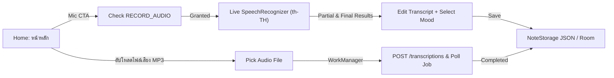

# Voice2Note — Roadmap Plan

Version: 1.0  
Platform: Android (Kotlin)  
Primary language: Thai-first  
Product type: Mobile voice journaling + speech-to-text notes

---

## 1. Product Goal

Voice2Note is a mobile app for users who want to **talk out their thoughts and feelings** and automatically turn speech into structured notes.

The first release focuses on:
- Thai live speech-to-text
- Emotional journaling
- Searchable notes
- Folder-based organization
- Clean and calming mobile experience

The long-term goal is to become a **searchable voice knowledge and reflection app**, supporting live capture, uploaded audio, transcript playback, and retrieval.

---

## 2. Product Positioning

### Core value
> Speak naturally, capture your feelings, and revisit your thoughts as organized notes.

### Target users
- Students who want quick note capture
- People who want a safe venting / journaling tool
- Users who prefer speaking over typing
- People who want searchable personal notes

### Differentiators
- Thai-first live STT
- Emotion-centered journaling
- Folder and note organization
- Async MP3 upload and background transcription
- Future karaoke-style transcript playback
- Future scoped search (library / folder / selected files / single file)

---

## 3. Product Scope by Phase

## Phase 1 — MVP: Live Speech Journal

### Goals
Validate the main journaling flow and Thai speech-to-text experience.

### Features
- Home screen with big record CTA
- Live speech-to-text note capture
- Emotion / mood selection after recording
- Save note with title, timestamp, and mood
- Notes list
- Search by note title / content
- Daily journal calendar view
- Folder creation and note grouping

### Acceptance criteria
- User can record and transcribe Thai speech in real time
- User can save note and assign mood tag
- User can browse past notes and folders
- User can search saved notes

---

## Phase 2 — Async Audio Upload

### Goals
Allow users to bring in existing audio and let the app process it in the background.

### Features
- Upload MP3 / M4A / WAV
- Async upload flow
- Background transcription job
- Progress / queued / failed / completed state
- Retry failed jobs
- Save processed audio as note item

### Acceptance criteria
- User can leave upload screen while job continues
- Uploaded file appears with correct processing status
- Completed transcript is attached to note item automatically

---

## Phase 3 — Better Note Organization

### Goals
Improve information architecture and daily usability.

### Features
- Folder CRUD
- Move notes between folders
- Custom folder colors / icons
- Sort by newest / oldest / custom order
- Pin important notes
- Filter by emotion tag
- Recent items and favorites

### Acceptance criteria
- Users can meaningfully organize their notes
- Folder browsing feels clean and efficient on mobile

---

## Phase 4 — Karaoke Transcript & Playback

### Goals
Introduce synchronized transcript playback.

### Features
- Audio playback page
- Transcript sync with playback
- Word-level or segment-level highlight
- Tap transcript to seek to a time point
- Resume playback state

### Acceptance criteria
- Transcript highlight follows playback in a stable way
- User can jump to a point in audio from transcript

---

## Phase 5 — Search Upgrade + Scoped Retrieval

### Goals
Move from simple note search to structured retrieval.

### Features
- Search scopes:
  - Whole library
  - Current folder
  - Selected files
  - Single file
- Keyword search
- Semantic retrieval (future)
- Search result opens the relevant note / segment

### Acceptance criteria
- Search results honor the selected scope
- User can quickly revisit the right note or transcript section

---

## Phase 6 — Reflection Intelligence (Future)

### Goals
Add helpful intelligence without breaking user trust.

### Features
- Note summary
- Reflection prompts
- Mood trend view
- Weekly emotional recap
- Suggested titles
- Gentle journaling prompts

### Caution
These features should feel supportive, not intrusive.

---

## 4. Technical Milestones

| Milestone | Focus             | Deliverable                                   |
|-----------|-------------------|-----------------------------------------------|
| M1        | Product structure | Navigation, app shell, base screens           |
| M2        | Live STT          | Thai live recording and transcript capture    |
| M3        | Notes persistence | Save, list, search, and calendar              |
| M4        | Folder system     | Create/manage folders and organize notes      |
| M5        | Async upload      | Background file upload + transcription states |
| M6        | Playback          | Audio note detail and transcript screen       |
| M7        | Karaoke sync      | Highlight + tap-to-seek prototype             |
| M8        | Scoped search     | Multi-scope retrieval                         |
| M9        | Intelligence      | Mood analytics / summary / prompt experiments |

### 4.1 Android Technical Architecture (Kotlin & Jetpack Compose)

- **Existing MVP baseline** (`app/src/main/java/com/example/cs265final/`):
  - Single-activity Jetpack Compose UI (`MainActivity.kt`) with feature composables (`HomeScreen.kt`, `LibraryScreen.kt`, `CalendarScreen.kt`, `NoteCard.kt`).
  - Live Thai STT via Android platform `SpeechRecognizer` (`RecognizerIntent.EXTRA_LANGUAGE = "th-TH"`, `EXTRA_PARTIAL_RESULTS = true`).
  - Local persistence via `NoteStorage.kt` (`SharedPreferences` + `org.json.JSONArray`).
- **Architectural discipline (`ponytail:`)**:
  - Keep `SharedPreferences` + `JSONArray`, platform `SpeechRecognizer`, and `java.net.HttpURLConnection` / `WorkManager` without adding Room, Hilt, or Retrofit prematurely.
  - **Upgrade trigger**: migrate `NoteStorage` to Room + SQLite FTS4 only when saved notes exceed ~1,000 items or Phase 5 scoped search requires indexed queries.
- **Coroutine & Lifecycle rules**:
  - Use structured concurrency (`lifecycleScope` / `viewModelScope`) with `StateFlow` for reactive state; never use `GlobalScope` or `runBlocking`.
  - Release platform audio/speech resources deterministically on teardown (`recognizer?.destroy()`, player release in `onCleared()` / `onDestroy()`).

#### Core Kotlin Domain & State Models

```kotlin
enum class Mood(val labelTh: String) {
    VERY_GOOD("ดีมาก"),
    GOOD("ดี"),
    NORMAL("ปกติ"),
    STRESSED("เครียด"),
    SAD("เศร้า"),
}

data class Note(
    val title: String,
    val body: String,
    val mood: String,
    val folder: String,
    val time: Long,
    val durationSec: Int = 0, // Phase 2/4 audio metadata
    val isUploaded: Boolean = false,
    val audioUri: String? = null,
)

sealed interface RecordingState {
    data object Idle : RecordingState
    data class Listening(val partialTranscript: String, val elapsedSec: Int) : RecordingState
    data class Paused(val transcript: String, val elapsedSec: Int) : RecordingState
    data class Error(val message: String) : RecordingState
}

sealed interface UploadUiState {
    data object Idle : UploadUiState
    data class Uploading(val progress: Float) : UploadUiState
    data class Processing(val jobId: String) : UploadUiState
    data class Done(val note: Note) : UploadUiState
    data class Error(val message: String, val canRetry: Boolean = true) : UploadUiState
}
```

### 4.2 Persistence Schema & Upgrade Path

- **Current JSON schema (`NoteStorage` in `SharedPreferences` key `"items"`)**:
  ```json
  [
    {
      "title": "ความรู้สึกหลังสอบวันนี้",
      "body": "...",
      "mood": "ปกติ",
      "folder": "ระบายความรู้สึก",
      "time": 1763190000000
    }
  ]
  ```
  *(Optional fields `durationSec`, `isUploaded`, `audioUri` use `optInt` / `optBoolean` / `optString` defaults for backward compatibility.)*
- **Target Phase 4/5 SQLite / Room tables**:
  - `notes(id TEXT PRIMARY KEY, title TEXT, body TEXT, mood TEXT, folder TEXT, time INTEGER, duration_sec INTEGER, is_uploaded INTEGER, audio_uri TEXT)`
  - `transcript_segments(id TEXT PRIMARY KEY, note_id TEXT, start_ms INTEGER, end_ms INTEGER, text TEXT)` for karaoke playback highlight and tap-to-seek.

### 4.3 Core User Flow Diagrams



### 4.4 Phase 2 Async Transcription API Contract

- **Submit audio job**: `POST /api/v1/transcriptions` (`multipart/form-data`: `file` MP3/M4A/WAV, `language="th"`)
  - Response `202 Accepted`:
    ```json
    { "jobId": "job_01J...", "status": "queued" }
    ```
- **Poll job status**: `GET /api/v1/transcriptions/{jobId}`
  - Response `200 OK`:
    ```json
    {
      "jobId": "job_01J...",
      "status": "completed",
      "text": "วันนี้รู้สึกค่อนข้างกดดันนิดหน่อยค่ะ...",
      "durationSec": 156,
      "segments": [
        { "startMs": 0, "endMs": 2400, "text": "วันนี้รู้สึกค่อนข้างกดดันนิดหน่อยค่ะ" }
      ]
    }
    ```
  - Valid `status` values: `"queued" | "processing" | "completed" | "failed"` (with nullable `"error"` message when `"failed"`).

---

## 5. Suggested Sprint Breakdown

## Sprint 1
- Finalize product scope
- Build design system tokens
- Implement app shell and bottom navigation
- Build home screen mock

## Sprint 2
- Live recording UI
- Thai STT integration prototype
- Save note flow
- Mood tagging UI

## Sprint 3
- Notes list
- Search screen
- Calendar journal screen
- Local persistence

## Sprint 4
- Folder management
- Note grouping
- Sorting and filtering
- Empty states

## Sprint 5
- Audio upload flow
- Background processing state model
- Async transcription backend contract

## Sprint 6
- Playback page
- Transcript rendering
- Metadata display
- Resume state

## Sprint 7
- Karaoke transcript sync prototype
- Tap-to-seek interactions
- Audio/transcript validation

## Sprint 8+
- Scoped search
- Semantic retrieval experiments
- Reflection intelligence

---

## 6. Testing Plan

### Functional testing
- Record note successfully
- Save mood tag successfully
- Create / rename / delete folder
- Upload MP3 and process in background
- Search notes by text
- Open saved note detail
- Calendar date opens matching notes

### UX testing
- Is the record CTA obvious?
- Does the app feel calm and safe?
- Are Thai labels understandable?
- Is note organization intuitive?

### Stress / robustness testing
- Long audio input
- Poor microphone quality
- Thai with English mixed terms
- App interrupted mid-recording
- Upload canceled or failed network

### Future testing
- Playback sync accuracy
- Search relevance
- Transcript-seek correctness

---

## 7. Documentation Checklist

- Product overview
- User flow diagrams
- Feature scope
- API contract for upload/transcription
- Design system documentation
- Test checklist
- Release notes template

---

## 8. MVP Definition of Done

The MVP is complete when a user can:
1. Open the app
2. Start speaking in Thai
3. See live transcript appear
4. Save the note with a mood tag
5. Reopen the saved note later
6. Search or browse the note in folders or by date

---

## 9. Immediate Next Steps

1. Convert current design direction into Figma screens
2. Build Android app shell in Jetpack Compose
3. Validate Thai live STT pipeline
4. Implement note persistence model
5. Run first usability pass on recording + journaling flow

