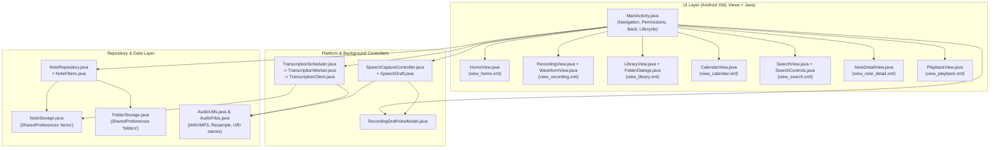
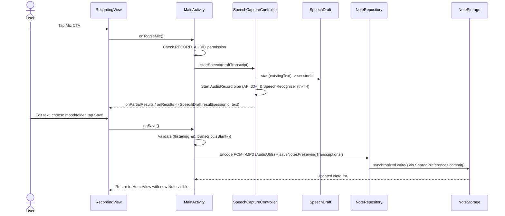
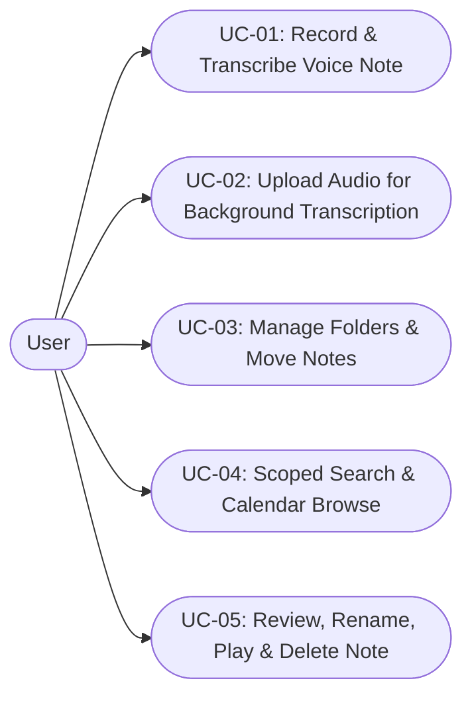

# Voice2Note — Architecture, Use Cases & Data Flows (`REQ-2.1`, `G18`)

## 1. Layered Java + XML Views Architecture (`UI -> Repository -> Data Source`)

### Folder vs. Audio Playback Distinction (`G07`)
- **Folders (`FolderStorage`):** Persistent category labels (`การเรียน`, `ระบายความรู้สึก`, `งาน / โปรเจกต์`, `ไอเดีย`, `ทั่วไป`, or user-created folders) that group notes for browsing (`LibraryView`) and search scoping (`SearchView`).
- **Audio Playback (`NoteDetailView` / `PlaybackView`):** Plays the audio file attached to a single selected `Note` via `MediaPlayer`. Folders do **not** act as ordered audio playlists.

---

## 2. Main Function Mechanism: Input → Processing → Output (`REQ-2.1`)

### Mechanism A: Voice Recording → Thai Live STT → Persistent Note

1. **Input:** User voice audio (`th-TH`) + keyboard edits + mood/folder/title selection.
2. **Processing:** `SpeechCaptureController` captures live STT callbacks into `SpeechDraft` (guarding against stale callbacks from prior sessions via monotonic `generation` IDs) while teeing 16 kHz mono PCM on API 33+. On Save, `MainActivity` validates that listening is stopped and transcript is non-blank, encodes PCM to MP3 (`AudioUtils.writeMp3File`) in `filesDir`, and constructs an immutable `Note` with a UUID `id`.
3. **Output:** `NoteRepository` persists the note via `NoteStorage` (`SharedPreferences.commit()`), ensures the folder is registered in `FolderStorage`, clears the draft, and updates `HomeView`.
4. **Error Paths:** Permission denied displays rationale/settings guidance; SpeechRecognizer timeout (15 s) or error preserves already captured text; storage read/write failures abort save and delete any newly written audio file without overwriting existing notes.

---

## 3. Use Case Diagram & Key Use Case Specification (`BM09 pp. 2–3`)

### Use Case Specification: `UC-01 — Record & Save Thai Voice Note`
- **Actor:** App User
- **Preconditions:** App is open on `HomeView`; device has microphone hardware (optional for text-only entry) and a speech recognition provider for live STT.
- **Basic Flow:**
  1. User taps **Start recording** (`button_home_record`) or **Create note** (`button_home_new_note`).
  2. `MainActivity` opens `RecordingView`.
  3. User taps Mic (`button_recording_mic`); `MainActivity` verifies `RECORD_AUDIO` permission and calls `SpeechCaptureController.startSpeech()`.
  4. User speaks Thai; partial and final transcripts update `input_recording_transcript`.
  5. User stops listening, optionally edits text/title/folder/mood, and taps **Save note** (`button_recording_save`).
  6. `MainActivity` encodes captured PCM to MP3 (if non-zero PCM exists) and saves via `NoteRepository`.
- **Alternative / Error Flows:**
  - *A1 (Permission denied):* Show `R.string.permission_mic_rationale` or `R.string.permission_mic_settings`; user can still type notes manually.
  - *A2 (Back pressed with unsaved draft):* `MainActivity` displays `R.string.discard_draft_title` confirmation dialog; Cancel retains draft, Confirm discards and exits composer.
  - *A3 (Save clicked while listening or blank):* Displays inline warning (`R.string.recording_error_still_listening` or `R.string.recording_error_empty_transcript`) without losing data.

---

## 4. Class Guide (For Team Walkthrough)

| Package | Class | Responsibility |
|---|---|---|
| `com.example.cs265final` | `MainActivity` | Host navigation (`Home`, `Library`, `Calendar`, `Search`, `Recording`, `Detail`, `Playback`), `OnBackPressedCallback`, runtime permissions, lifecycle state save/restore |
| `data` | `Note`, `AudioSource`, `TranscriptionStatus` | Immutable domain models with stable UUID `id` |
| `data` | `NoteStorage`, `FolderStorage`, `NoteRepository` | Thread-safe JSON persistence (`SharedPreferences`), legacy migration, folder CRUD & note reassignment |
| `data` | `NoteFilters`, `AudioUtils`, `AudioFiles` | Pure filtering/search, WAV/MP3 encoding, resampling, content URI filename lookup |
| `speech` | `SpeechDraft`, `SpeechCaptureController`, `RecordingDraftViewModel` | Session-safe transcript merging, `SpeechRecognizer` + `AudioRecord` mic-tee management, rotation-safe PCM buffer |
| `transcription` | `TranscriptionClient`, `TranscriptionWorker`, `TranscriptionScheduler` | HTTP multipart upload & polling, `WorkManager` background worker, retry/cancel scheduling |
| `feature/*` & `ui` | `HomeView`, `LibraryView`, `FolderDialogs`, `CalendarView`, `SearchControls`, `SearchView`, `SearchResultView`, `RecordingView`, `NoteDetailView`, `DeleteNoteConfirmation`, `PlaybackView`, `PlaybackHelper`, `WaveformView`, `UiLabels` | XML-inflated custom Views, dialogs, media playback lifecycle, localized label mapping |
